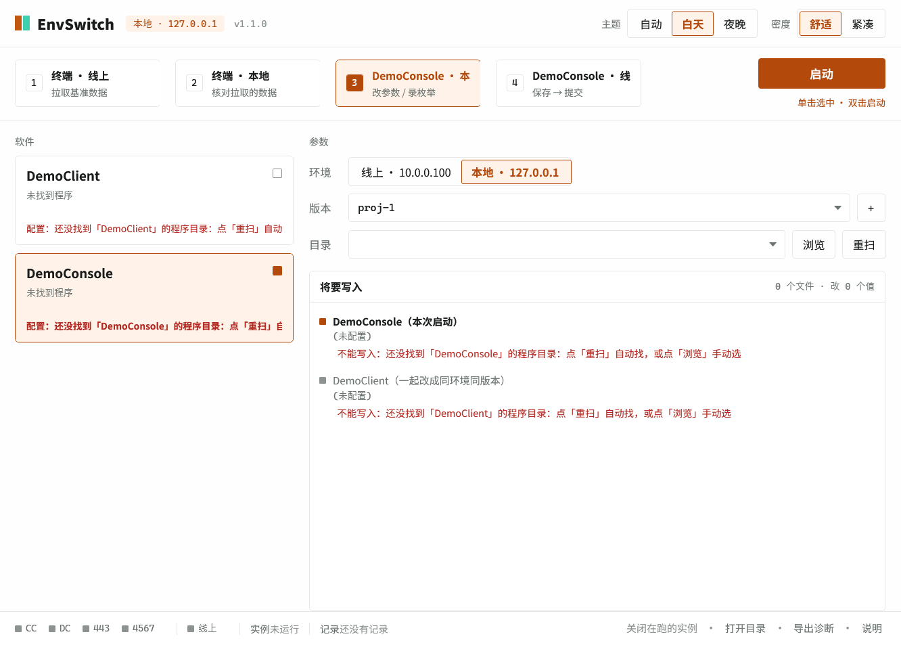
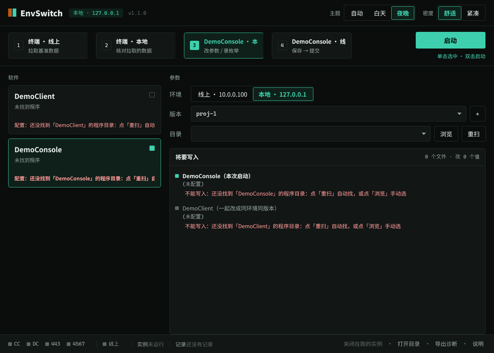

# EnvSwitch · 环境启动器

> 一个 200 KB 的免安装 Windows 小工具：把「多个客户端软件 × 线上/本地环境 × 多个项目版本」的组合切换，从**手改配置文件**变成**点一下**——而且改配置文件这件事，做得比人手工改更安全。

<p align="center">
  
</p>

<p align="center">
  
  
  
  
  
</p>

---

## 它解决什么问题

一类常见的内网工具链是这样的：**客户端 + 管理端两套程序，各自靠同目录的 JSON 配置文件决定连哪套服务（线上/本地）、以及用哪个项目版本**。于是每次切环境都要：

> 关程序 → 打开编辑器改 JSON → 保存 → 重开程序 → 登录 → 退出 → 再改 JSON → 再重开 → 再登录……

`EnvSwitch` 把这一串压成**一次点击**，并且顺手解决了三个手工改容易翻车的点：

| 手改配置文件的风险 | EnvSwitch 的做法 |
|---|---|
| 改错键、多加/少加逗号，把配置写坏 | **只替换目标值的字符串**，其余字节（缩进、换行、键顺序）**逐字不动**；写前校验、写后回读比对 |
| 两个程序的配置不一致（一个线上一个本地） | 一次点击**把两个文件同时**改成同环境同版本 |
| 程序开着改配置不生效（只在启动时读） | 启动前检测在跑的实例，先请你确认关闭，再写配置、再拉起 |
| 改坏了回不去 | 写入失败或回读不符会**按原文自动还原**；自检带「真文件往返 + SHA-256 比对」 |

## 特性

- **零依赖**：目标框架 .NET Framework 4.8（Windows 10/11 自带），单个 `EnvSwitch.exe` ≈ 180 KB，解压即用，不需要装运行时、不需要管理员权限。
- **自动识别**：不看目录名，靠三重签名认出目标程序——① 文件名 ② PE 版本信息里的 `ProductName` ③ 同目录 `appsettings.json` 且含必需键。识别结果分级（可用 / 疑似）并写回自己的配置，第二次秒开。
- **逐字节安全的写入**：正则替换 + 掩码不变性校验 + 回读校验 + 失败还原；UTF-8 无 BOM / CRLF / 缩进风格全部保持。
- **看得见的预览**：界面「将要写入」把每一行 `旧值 → 新值` 摊开，**显示的就是实际写进去的**（预览与写入共用同一份计划对象）。
- **单击/双击语义明确**：工作流按钮**单击=选中**、**双击=启动**；选中态用主题色描边 + 淡底 + 序号块高亮，四个按钮等宽不挤压。
- **昼夜双主题**：白天橙 + 纯白底，夜晚湖绿 + 近黑底；色值经 WCAG 对比度实测（正文 ≥ 4.5:1、图形 ≥ 3:1），随时间自动切换，也可锁定。
- **出问题能定位**：标题旁版本号；底部「导出诊断」一键生成含配置、目标配置、识别结果、服务/端口状态、最近日志的 txt。

## 界面

| 白天（橙色 / 纯白底） | 夜晚（湖绿 / 近黑底） |
|---|---|
|  |  |

左侧卡片显示两个目标程序的**真实配置现状**（程序版本、目录、以及它 `appsettings.json` 里当前的 url 主机与版本）；右侧是参数与「将要写入」；底部是服务/端口/实例状态。

## 快速开始

1. **解压**任意位置（建议放在目标程序**同一个盘**，例如 `D:\Tools\`）。
2. **双击 `EnvSwitch.exe`**。若 Windows 提示未知发布者，点【更多信息】→【仍要运行】。
3. 首次启动会**自动扫描并认出**目标程序，把目录与项目版本写进 `配置.json`；之后选好环境与版本，点【启动】或双击工作流按钮即可。

没自动找到时：点【重扫】，或【浏览】手动指定，或把本工具解压到目标程序旁边再【重扫】。详见 [`docs/QUICKSTART.md`](docs/QUICKSTART.md)。

## 怎么识别目标程序

```
① 文件名        DemoClient.exe / DemoConsole.exe
② 程序身份      PE 版本信息 ProductName == DemoClient / DemoConsole   ← 改名换目录也认得出，假文件挡得住
③ 目录配套      同目录 appsettings.json 且含 API_Access.url + TERMINAL_Access.ProjectName
```

三条全过 = **可用**；只过 ① ② = **疑似**（界面提示但不让启动，避免写到错的目录）。搜索范围：自身目录子树（深度 5）+ 上一级目录子树（深度 3），跳过系统/临时目录，带目录数与时间预算，不会卡住界面。

## 接到你自己的程序上

改 `src/识别.cs` 里三个常量即可（其余逻辑不用动）：

```csharp
ExpectedExe("terminal")     // "DemoClient.exe"
ExpectedProduct("terminal") // "DemoClient"   ← 对应目标程序 PE 里的 ProductName
Label("terminal")           // 界面上显示的名字
```

再用 `--找一找 <目录>` 验证：

```powershell
.\EnvSwitch.exe --找一找 "D:\Tools"     # 打印识别结果与默认选中项，不开窗口
```

## 常用命令行（排障用）

| 命令 | 作用 |
|---|---|
| `--找一找 [目录]` | 只做识别并把结果打到控制台（自检/排障） |
| `--自检 [--含真文件往返]` | 写入安全自检：4 组副本改写 + 4 个反例 + 配置往返（+ 可选真文件往返 SHA-256 比对） |
| `--截图 白天\|夜晚 <png>` | 离屏渲染出真实界面截图 |
| `--写默认配置 <目录>` | 生成一份默认 `配置.json` |
| `--帧率 [毫秒]` | 实测滑块动画帧率（含「本会话可渲染上限」基准） |

## 项目结构

```
src/           C# 源码（WPF 单工程，net48）
  ├─ 界面.xaml(.cs)      主窗、状态条、逐行 diff 预览、工作流交互
  ├─ 配置.cs             自身配置模型 + 自带 JSON 读写（不引第三方库）
  ├─ 写入配置.cs         目标 appsettings.json 的安全改写（正则 + 掩码校验 + 回读 + 还原）
  ├─ 识别.cs             三重签名识别与有界扫描
  ├─ 运行时.cs           服务/端口探测、进程关闭、运行记录、诊断导出
  ├─ 滑块.cs             分段滑块拇指动画（只动渲染层变换，不触发布局）
  └─ 主题-白天/夜晚.xaml  两套色板 token
tools/         Python：图标生成、像素级版面体检、WCAG 对比度体检
scripts/       自检.ps1（写入安全自检）、打包.ps1（产出「解压即用」zip）
docs/          快速上手
screenshots/   界面截图
assets/        README 用的动效 SVG
```

## 设计与验证

- 「写入安全」不靠嘴说：`scripts/自检.ps1` 会跑副本改写、反例拦截、配置往返与真文件往返（SHA-256 前后一致）。
- 动效只使用渲染层变换（`TranslateTransform`）与等宽分段，动画期间不触发布局；滑块动画帧率可用 `--帧率` 自测——注意**帧率上限由会话的合成能力决定**（远程串流桌面约 30 帧，本地屏跟随刷新率）。
- 色板来源与对比度实测值见 `tools/对比度体检.py` 的输出（正文 16.8:1，次要 4.8:1 等）。

## 常见问题

| 现象 | 说明 |
|---|---|
| 「本地」环境不可用 | 本机没装对应的本地服务（界面会明确提示），改用「线上」或找系统管理员 |
| 目标程序正在运行 | 切环境需要先关闭（程序只在启动时读配置）；工具会先请你确认，不会静默杀进程 |
| 提示「缺少 XX 字段」 | 目标配置文件结构不符，工具**拒绝写入**且不擅自加键，请人工核对 |
| 杀软 / SmartScreen 拦截 | 免安装小工具，加信任即可；`打包.ps1` 产出的 zip 里另附 `启动EnvSwitch.cmd` 备用入口 |

## License

[MIT](LICENSE)

<!-- 推荐项目:start -->
## 推荐项目

同一作者维护的其他开源项目，欢迎一并看看：

| 项目 | 简介 |
| --- | --- |
| **[dsh-chime](https://github.com/HtO404/dsh-chime)** | Task-completion notification chime for the DSH web GUI: beeps when an agent turn finishes, even in background tabs. 10 preset sounds + custom import + volume. |
| **[yanxi-lake-dashboard](https://github.com/HtO404/yanxi-lake-dashboard)** | 网页/前端、文档项目（64 个文件） |
| **[FFood](https://github.com/HtO404/FFood)** | 家庭食材新鲜管理系统 |
| **[Huace](https://github.com/HtO404/Huace)** | 网页/前端、Python、文档项目（400 个文件） |
| **[kenji-birthday-cake](https://github.com/HtO404/kenji-birthday-cake)** | 仟吉生日蛋糕定制Demo - 支持场景选择、蛋糕模板、配色/装饰/文字/尺寸/口味定制、预览下单 |
| **[-uiautomator-](https://github.com/HtO404/-uiautomator-)** | 基于uiautomator库对安卓设备进行自动化测试，模拟手动点击行为 |

<!-- 推荐项目:end -->
